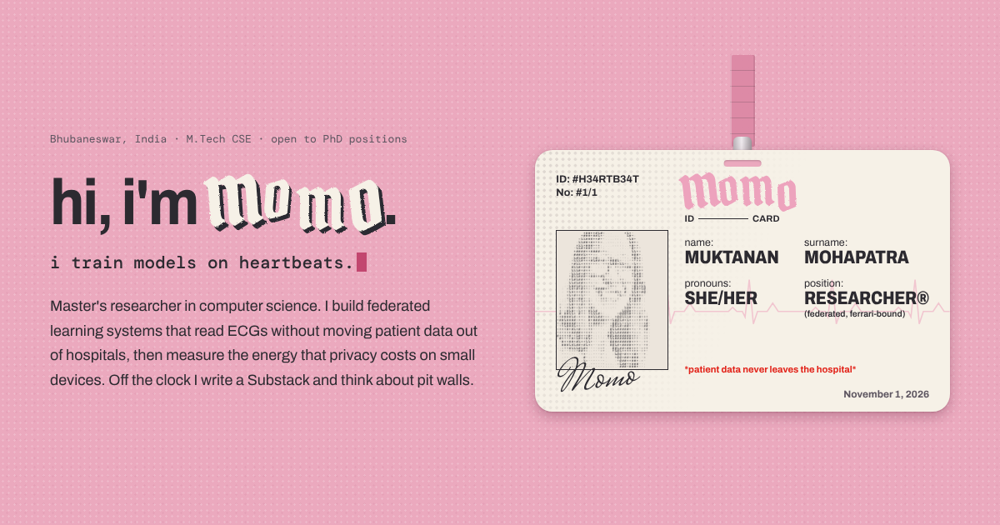

# momo · portfolio

Personal site of **Muktanan (Momo) Mohapatra**, ML researcher working on federated learning for cardiac ECG.

The hero is a lanyard ID card: an ASCII portrait that scatters when you hover over it, deadpan ID fields, and a thorny back you can flip to. Below it is a cream dossier with sections for research, projects, writing and contact.



## Stack

- Next.js 15 (App Router), React 19, TypeScript
- Plain CSS in `app/globals.css`, no UI framework
- One small vanilla script, `public/site.js`, for the interactive parts
- Fonts from Google Fonts: Pirata One, Archivo, DM Mono, Mrs Saint Delafield

## Run it

```bash
npm install
npm run dev        # http://localhost:3000
npm run build      # production build
npm run typecheck  # TypeScript check
```

## Where things live

| File | What it holds |
| --- | --- |
| `app/data.ts` | Every word on the site: card fields, about text, jobs, research, projects, writing, education, links |
| `app/page.tsx` | Page structure and markup |
| `app/globals.css` | All styling. Colour and font tokens are at the top |
| `public/site.js` | Typewriter, ASCII portrait, card tilt and flip, thorns, experience tabs, copy-email button |
| `public/me.jpg` | Source photo for the ASCII portrait |
| `app/icon.svg` | Browser tab icon |
| `app/opengraph-image.png` | Image shown when the link is shared |

## Common edits

- **Add LinkedIn or a CV:** fill in `linkedin` or `cv` in `app/data.ts`. For the CV, put `cv.pdf` in `public/` and set `cv: "/cv.pdf"`. Empty links stay hidden.
- **Change the portrait:** replace `public/me.jpg`. A head-and-shoulders crop on a plain white background works best. Without a photo, the card draws an ASCII heart.
- **Add a project:** add an entry to `projects` in `app/data.ts`. The card numbering updates on its own.
- **Recolour:** edit the tokens at the top of `app/globals.css`.

## Deploy

On [vercel.com](https://vercel.com), choose **New Project**, import this repository, and press **Deploy**. Vercel detects Next.js automatically and redeploys on every push to `main`.

## Credits

Designed and built by Muktanan Mohapatra. Inspired by a pink ID card and [Gazi Jarin's website](https://www.gazijarin.com). The card is drawn at ISO/IEC 7810 ID-1 proportions (85.60 × 53.98 mm).
